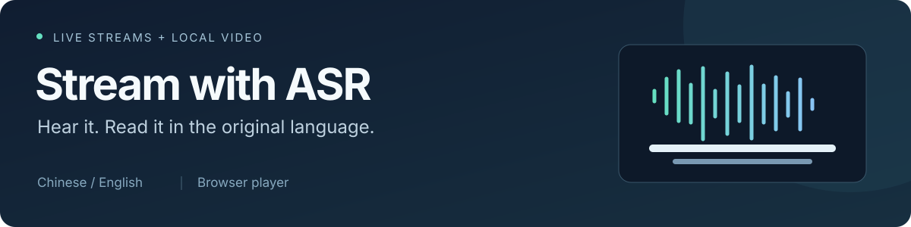

<p align="center">
  
</p>

<h1 align="center">Live and video captions</h1>

<p align="center">Watch in your browser. Chinese speech stays Chinese; English speech stays English.</p>

<p align="center">
  <a href="https://github.com/AiKiAi-stack/stream-with-asr/actions/workflows/test.yml"></a>
  
  <a href="LICENSE"></a>
  
</p>

<p align="center">
  <b>English</b> · <a href="README_zh.md">简体中文</a><br>
  <a href="#quick-start">Quick start</a> · <a href="#how-to-use">Usage</a> · <a href="#status-and-limits">Status</a> · <a href="#development-and-documentation">Development</a>
</p>

## What you can do

- Play a live URL or local video with original-language captions from DashScope FunASR. Chinese and English are detected automatically by default.
- Select a channel or file before starting playback. The video shows stable phrases with speech timestamps; the caption history keeps the full text.
- Pause, resume and seek within a fully transcribed local file using the existing captions.
- Share a read-only live viewer link with devices on your LAN, reusing the host's recognition session.

> **Experimental preview.** The current UI focuses on original-language captions; cross-language translation is paused. Startup and fixed-input long-run checks have preview acceptance records. Independent acoustic synchronization and voiced coverage have not passed formal acceptance. [See current status](#status-and-limits).

## Quick start

You need **64-bit Python 3.10–3.12** (3.12 recommended) and a **mainland-China DashScope API key** with `fun-asr-realtime` enabled. The cloud WebUI needs no local GPU, model download or separate system FFmpeg installation.

Download and extract this repository, or clone it:

```bash
git clone https://github.com/AiKiAi-stack/stream-with-asr.git
cd stream-with-asr
```

### Windows

Enable the Python Launcher when installing Python, then double-click **`start-windows.cmd`**.

The launcher creates a project-local `.venv`, installs the WebUI dependencies and opens [http://127.0.0.1:8002/](http://127.0.0.1:8002/). Apply your key in Settings, then choose your content.

### Linux / manual setup

From the repository directory:

```bash
python3.12 -m venv .venv
source .venv/bin/activate
python -m pip install -r requirements-webui.txt
python tools/webui.py --host 127.0.0.1 --port 8002
```

Substitute your interpreter name on the first line if using Python 3.10 or 3.11. Open [http://127.0.0.1:8002/](http://127.0.0.1:8002/) and apply your key in Settings.

## How to use

| Step | Action |
| --- | --- |
| **1. Choose content** | Paste a live URL. For an M3U channel list, click **选择频道** (Select channel). Or click **打开文件** (Open file) to choose a local video. |
| **2. Play with captions** | Click **播放并生成字幕** (Play and generate captions). Playback starts when captions are ready. Selecting a channel alone does not start recognition. |

Below the player, toggle captions, open the caption history or enter fullscreen. Adjust caption size and position in Settings. The current interface labels are in Chinese.

You can seek directly within fully transcribed local files. Seeking to a position that is not ready may require another recognition session; the UI warns you first. During live playback, video and audio may pause together while waiting for captions. Public sources can also have network, regional or account restrictions.

### Watch on your LAN

Start with `python tools/webui.py --host 0.0.0.0 --port 8002`. The host still opens the management page locally. Once a live session starts, copy its viewer link from Settings. Select a reachable address if the host has multiple adapters, and allow port `8002` through the firewall on your private network.

Each live session allows up to three viewer devices. Viewers need no separate key or recognition session. The link expires when the live session stops.

### Need a reliable test source?

Start with a local long video to check the viewing flow. For development, files can also be replayed in real time as rolling HLS. See the [public channel list](examples/public-live-channels.m3u) and [Chinese/English news replay guide](docs/research/p0-local-news-2026-11-04.md). Public URLs are not guaranteed to stay available; test media must be supplied separately.

## Cloud costs and keys

Audio is sent to DashScope and billed to your API account. The connection check also connects to the cloud ASR service. The current default flow makes no translation requests.

Keys stay in server memory by default. On Windows, optional persistence uses user-bound DPAPI encryption. Keys are not stored in browser localStorage, URLs or ordinary logs. Deleting the configuration removes the saved file and stops cloud sessions.

For local offline transcription, see the [FunASR Vulkan guide](docs/funasr-vulkan.md). That mode transcribes an entire file before playback and does not support live captions.

## Status and limits

These results cover the PR #89 candidate tested on **2026-11-04**. Preview acceptance thresholds are recorded in [ADR-0009](docs/adr/0009-pr89-preview-acceptance-2026-11-04.md).

| Area | Current result |
| --- | --- |
| Startup | 20 fixed-HLS starts per language: Chinese P95 **5.014 s**, English **4.470 s**. Both meet the preview's 5.5 s threshold; the original 3 s target remains. |
| Long-run replay | **30 minutes per language** with fixed news inputs and no reported application errors. Application-timeline delay proxy growth stayed within 1 s; this proxy does not establish independent acoustic synchronization. |
| Caption synchronization and voiced coverage | **Not yet validated.** Some short caption pages, blank intervals and recognition errors still need improvement. |
| Public sources and devices | Public streams need individual checks. Clean Windows installation and a real second device are outside this acceptance round and are not marked passed. |

The preview can be used within this scope; the formal first-release gate has not fully passed. See the [acceptance recheck](docs/plans/2026-11-04-pr89-acceptance-recheck.md) for full results. Historical failures and known text-quality issues remain in the [recovery record](docs/research/original-caption-recovery-2026-11-02.md).

## Troubleshooting

<details>
<summary>Video plays, but captions are missing</summary>

Check that you applied your key in Settings and clicked Play and generate captions. Make sure captions are enabled, then check the status message and caption history. Try a local video to distinguish a public-source problem. If an error remains, open the diagnostic log in Settings and remove secrets before sharing it.

</details>

<details>
<summary>The Windows launcher does not start</summary>

From the repository directory, run:

```powershell
.venv\Scripts\python.exe tools\windows_launcher.py --check
```

The launch log is `logs/webui-windows.log`. Configuration is under `.data/`; uploaded video copies are under `uploads/`.

</details>

## Development and documentation

```bash
python -m pip install -e . pytest playwright
python -m pytest test/ -v
node --test test/*.test.cjs
```

Frontend checks need Node.js (CI uses 22). Unit regressions need no real key. Real recognition acceptance runs separately and incurs cloud charges.

| Document | Contents |
| --- | --- |
| [Product decision](docs/adr/0008-original-language-captions.md) · [Glossary](GLOSSARY.md) | Caption scope, behavior and terminology |
| [Preview acceptance decision](docs/adr/0009-pr89-preview-acceptance-2026-11-04.md) | Preview thresholds and remaining release gaps |
| [News replay tests](docs/research/p0-local-news-2026-11-04.md) | Fixed long videos, rolling HLS and caption fix evidence |
| [Issues](https://github.com/AiKiAi-stack/stream-with-asr/issues) | Report problems with reproduction steps, OS version and redacted logs |
| [Historical toolkit documentation](docs/archive/streamparser.md) | Original stream processing, configuration and architecture references, including commands and components no longer provided |

## License

[MIT](LICENSE). Cloud recognition uses Alibaba Cloud DashScope; media processing includes PyAV.
