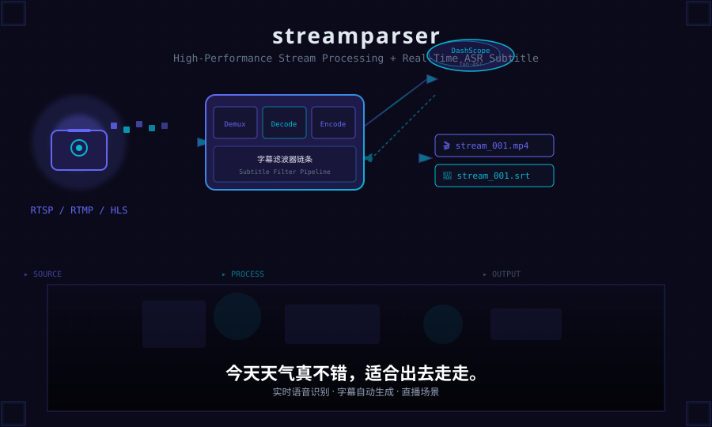

[English](./README.md) | [中文](./README_zh.md)

<p align="center">
  
</p>

# streamparser

高性能流媒体处理与解析工具包，支持实时 ASR 字幕生成。

一站式处理直播流（RTSP/RTMP/HLS）或本地媒体文件，按需转码，并可接入阿里云 DashScope 实时语音识别，将字幕实时烧录到视频画面中。

## 特性

### 核心流处理

- **多协议支持** — RTSP、RTMP、HLS、HTTP、UDP、TCP、本地文件
- **硬件加速** — CUDA、VAAPI、QSV、Vulkan、VideoToolbox
- **灵活编码** — 视频：H.264、H.265、VP9、AV1；音频：AAC、MP3、FLAC、WAV
- **画质预设** — LOW（2Mbps/15fps）、MEDIUM（4Mbps/30fps）、HIGH（8Mbps/60fps）
- **自动分段** — 按时长或文件大小自动轮转容器
- **帧过滤器链** — 可插拔的帧处理管道
- **流健康检测** — 启动前连通性检查 + 帧质量分析
- **自动重连** — 可配置的指数退避重试机制

### ASR 实时字幕

- **实时语音识别** — 基于阿里云 DashScope `fun-asr-realtime` 模型
- **画面烧录字幕** — 通过 Pillow 将中文文本直接渲染到视频帧上
- **SRT 文件输出** — 与输出视频容器同步分段生成 `.srt` 字幕文件
- **字级时间戳** — 精确的句级和字级对齐，实现精准字幕
- **自动重连** — WebSocket 断开后指数退避自动恢复
- **CJK 字体支持** — 自动探测系统字体（文泉驿正黑、Droid Sans Fallback），可配置自定义字体路径

## 安装

需要 Python 3.10–3.12 和 FFmpeg 运行时库。

```bash
git clone https://github.com/your-org/streamparser.git
cd streamparser
pip install .
```

使用 ASR 字幕功能需要 DashScope API Key：

```bash
export DASHSCOPE_API_KEY=sk-xxxxxxxxxxxxxxxx
```

## 快速开始

### 基础流处理

读取 RTSP 流，以中等画质保存为 H.264 MP4：

```bash
streamparser rtsp://192.168.1.100:554/live
```

### YAML 配置文件

完整控制编解码器、画质和输出参数：

```yaml
# config.yml
url: rtsp://192.168.1.100:554/live
type: BOTH
codec:
  video: h264
  audio: aac
quality:
  read: null
  write: high
directory: output
max_container_duration: 1800
max_retry_count: 5
```

```bash
streamparser config.yml
```

### 实时字幕

通过独立配置文件启用 ASR 字幕：

```bash
streamparser rtsp://192.168.1.100:554/live --asr examples/asr_config.example.yml
```

输出目录中视频与字幕文件成对出现：

```
output/
├── 0_20260709_143000.mp4
├── 0_20260709_143000.srt
├── 1_20260709_143030.mp4
└── 1_20260709_143030.srt
```

## 配置说明

### 流媒体设置 (`config.yml`)

| 字段 | 类型 | 默认值 | 说明 |
|---|---|---|---|
| `url` | string | — | 流地址或本地文件路径 |
| `type` | enum | `BOTH` | `VIDEO`、`AUDIO` 或 `BOTH` |
| `protocol` | enum | 自动 | 强制协议：`RTSP`、`RTMP`、`HLS`、`HTTP`、`TCP`、`UDP`、`FILE` |
| `codec.video` | string/enum | `h264` | 视频编码：`h264`、`h265`、`vp9`、`av1` |
| `codec.audio` | string/enum | `aac` | 音频编码：`aac`、`mp3`、`wav`、`flac` |
| `quality.read` | enum | `null` | 读取质量：`null`、`low`、`medium`、`high` |
| `quality.write` | enum | `medium` | 写入质量：`low`、`medium`、`high` |
| `directory` | string | `results` | 输出目录 |
| `max_container_duration` | int | `1800` | 最大分段时长（秒） |
| `max_container_byte_size` | int | `4GB` | 最大分段大小（字节） |
| `max_retry_count` | int | `5` | 最大重连次数 |
| `max_retry_wait_time` | float | `60.0` | 重连最大等待时间（秒） |
| `timeout` | float | `10.0` | 打开流超时（秒） |
| `queue_size` | int | `100` | 内部帧队列大小 |

### 硬件加速

在编解码器配置中添加 `hwaccel_type`：

```yaml
codec:
  video:
    name: h264
    encoder: libx264
    decoder: libx264
    format: mp4
    type: VIDEO
    hwaccel_type: CUDA    # CUDA、VAAPI、QSV、VULKAN 或 VIDEOTOOLBOX
```

### ASR 字幕设置 (`asr_config.yml`)

| 字段 | 类型 | 默认值 | 说明 |
|---|---|---|---|
| `provider` | string | `dashscope` | ASR 服务商 |
| `api_key` | string | `${DASHSCOPE_API_KEY}` | API Key（支持 `${环境变量}` 语法） |
| `workspace_id` | string | `""` | 百炼业务空间 ID |
| `region` | string | `cn-beijing` | 服务地域 |
| `model` | string | `fun-asr-realtime` | ASR 模型 |
| `reconnect.max_retries` | int | `10` | WebSocket 最大重连次数 |
| `reconnect.base_delay` | float | `1.0` | 初始重连等待（秒） |
| `reconnect.max_delay` | float | `30.0` | 重连等待上限（秒） |
| `subtitle.font_path` | string | `""` | 自定义字体路径（留空自动探测） |
| `subtitle.font_size` | int | `32` | 字幕字号 |
| `subtitle.max_lines` | int | `2` | 最大同时显示行数 |
| `subtitle.position` | string | `bottom` | 位置：`bottom` 或 `top` |
| `subtitle.offset_y` | int | `20` | 距边缘垂直偏移（像素） |
| `subtitle.text_color` | list | `[255,255,255]` | 文字颜色 RGB |
| `subtitle.stroke_color` | list | `[0,0,0]` | 描边颜色 RGB |
| `subtitle.stroke_width` | int | `2` | 描边宽度（像素） |

## 架构

```
                         StreamProcessor
┌──────────────────────────────────────────────────────────────┐
│                                                              │
│  StreamReader ── 队列 ── _process() ── 队列 ── Writer       │
│      │                       │                               │
│      │ 音频帧 → ASR filter    │ 视频帧 → SubtitleOverlay     │
│      │                       │                               │
│      └───────┬───────────────┘                               │
│              ▼                                               │
│  ┌─────────────────────────────┐                            │
│  │   ASRSubtitlePipeline        │                            │
│  │  ┌───────────────────────┐  │                            │
│  │  │  ASRClient             │  │                            │
│  │  │  DashScope WebSocket   │  │                            │
│  │  │  AudioProcessor        │  │                            │
│  │  └───────────┬───────────┘  │                            │
│  │              ▼               │                            │
│  │  ┌───────────────────────┐  │                            │
│  │  │   subtitle_buffer      │  │                            │
│  │  └─────┬─────────┬───────┘  │                            │
│  │        ▼         ▼           │                            │
│  │  SubtitleOverlay  SRTWriter  │                            │
│  │  (Pillow 渲染)    (文件 I/O) │                            │
│  └─────────────────────────────┘                            │
└──────────────────────────────────────────────────────────────┘
```

系统运行在三个线程上：
- **Reader 线程** — PyAV 解码 + 帧过滤器链
- **Writer 线程** — PyAV 编码 + 容器封装
- **ASR 工作线程** — 音频重采样、WebSocket 收发、回调分发

### 数据流

1. `StreamReader` 通过 PyAV 从源解码音视频帧
2. 音频帧经过 `AudioProcessor`（重采样到 16kHz 单声道 s16）
3. PCM 数据以 100ms 为单位通过 WebSocket 发送到 DashScope
4. ASR 识别结果通过回调异步返回 → 存入 `subtitle_buffer`
5. `SubtitleOverlay`（注册为帧过滤器）读取缓冲区，用 Pillow 将文本渲染到视频帧上
6. `SRTWriter` 将完成的句子写入 `.srt` 文件，与输出容器分段同步
7. `StreamWriter` 将修改后的帧（含烧录字幕）编码写入输出文件

## 开发

```bash
# 安装开发依赖
pip install -e ".[dev]"

# 运行全部测试
pytest test/ -v

# 运行单个测试文件
pytest test/test_asr_client.py -v
```

测试遵循严格的 TDD 流程，外部依赖通过 `unittest.mock` 隔离，单元测试不产生真实 API 调用。

## 依赖

| 包 | 用途 |
|---|---|
| `av` (PyAV) | FFmpeg 绑定 — 音视频编解码 |
| `opencv-python` | 视频帧处理 |
| `numpy` | 数组运算 |
| `librosa` | 音频分析 |
| `dashscope` | 阿里云 ASR SDK |
| `Pillow` | CJK 字幕文字渲染 |
| `pyyaml` | 配置文件解析 |
| `concurrent-log-handler` | 多进程安全日志 |
